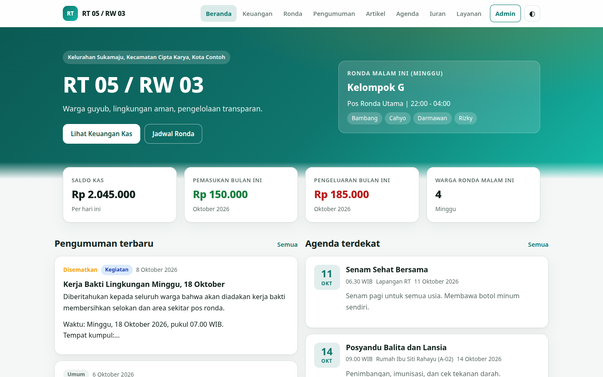

<p align="center">  </p>

# RT/RW Dashboard

Website dashboard untuk RT/RW: kas pemasukan dan pengeluaran, jadwal ronda, pengumuman, artikel, agenda, iuran warga, kontak penting, dan kotak aspirasi. **Tanpa database dan tanpa dependensi**: semua data disimpan sebagai file JSON di folder `data/`, dan diedit lewat panel admin di folder `admin/`.

Neighborhood (RT/RW) dashboard website: cash book, patrol schedule, announcements, articles, events, resident dues, important contacts and a suggestion box. **No database and no dependencies**: all data lives in JSON files inside `data/` and is edited from the admin panel in `admin/`.

**Bahasa / Language:** [Indonesia](#-bahasa-indonesia) | [English](#-english)

---

# 🇮🇩 Bahasa Indonesia

## Fitur

**Untuk warga (halaman publik)**

- **Beranda**: saldo kas, pemasukan dan pengeluaran bulan ini, siapa yang ronda malam ini, pengumuman, agenda, artikel, dan nomor darurat.
- **Keuangan Kas**: tabel transaksi, filter bulan, jenis, dan kategori, grafik 6 bulan, unduh CSV, dan cetak laporan.
- **Jadwal Ronda**: jadwal 7 hari, hari ini otomatis ditandai.
- **Pengumuman**: kategori, pencarian, dan sematan pengumuman penting.
- **Artikel**: daftar, pencarian, halaman baca, dan tombol bagikan.
- **Agenda Kegiatan**: kegiatan mendatang dan yang sudah lewat.
- **Status Iuran**: jumlah KK yang sudah bayar per bulan, rincian per warga bisa disembunyikan.
- **Layanan Warga**: kontak penting (telepon dan WhatsApp), inventaris RT, pembuat surat pengantar RT yang bisa dicetak, dan kotak aspirasi.
- Tampilan modern dengan navbar, footer, mode gelap, dan responsif untuk HP.
- Bisa dijalankan di VPS, panel hosting Node.js, atau **Vercel**.

**Untuk pengurus (`/admin`)**

- Tambah, ubah, dan hapus: transaksi, jadwal ronda, pengumuman, artikel, agenda, kontak, inventaris, dan data KK.
- **Iuran**: centang lunas per KK per bulan. Otomatis tercatat sebagai pemasukan di kas, dan ikut terhapus bila dibatalkan.
- **Aspirasi**: baca kiriman warga, ubah status (baru, diproses, selesai), dan beri catatan.
- Unggah gambar untuk artikel dan pengumuman.
- **Pengaturan**: nama RT/RW, saldo awal, nominal iuran, ganti password, serta backup dan pemulihan data.

## Kebutuhan

- Node.js 18 atau lebih baru. Tidak perlu `npm install`.

## Cara menjalankan

```bash
# 1. Salin file contoh pengaturan
cp .env.example .env

# 2. Buka .env lalu ganti ADMIN_PASSWORD

# 3. Jalankan
npm start
```

Buka `http://localhost:3000` untuk website dan `http://localhost:3000/admin` untuk panel admin.

Di Windows, salin file dengan `copy .env.example .env`, atau buat file `.env` secara manual.

## Pengaturan `.env`

| Nama | Fungsi |
| --- | --- |
| `PORT` | Port website. Bawaan `3000`. |
| `ADMIN_PASSWORD` | Password admin awal. Setelah kamu menggantinya di panel admin, nilai ini tidak dipakai lagi. |
| `SESSION_SECRET` | Rahasia sesi login (teks acak). Boleh kosong, nanti dibuat otomatis. |
| `TZ_NAME` | Zona waktu untuk tanggal "hari ini". Bawaan `Asia/Jakarta`. |
| `TRUST_PROXY` | Isi `1` bila website berjalan di belakang proxy atau HTTPS (Nginx, Cloudflare, Railway, Render). |
| `COOKIE_SECURE` | Isi `1` bila memakai HTTPS agar cookie admin hanya dikirim lewat HTTPS. |
| `GITHUB_REPO`, `GITHUB_TOKEN`, `GITHUB_BRANCH` | Hanya untuk Vercel, lihat [Deploy ke Vercel](#deploy-ke-vercel). |

## Panduan memakai panel admin

1. Buka `/admin` dan masuk dengan password dari `.env`.
2. Buka **Pengaturan** dan isi nama RT/RW, wilayah, saldo awal kas, serta nominal iuran. Ganti password di halaman yang sama.
3. **Mencatat uang**: menu **Keuangan** lalu **Tambah transaksi**. Pilih jenis (pemasukan atau pengeluaran), kategori, keterangan, dan jumlah.
4. **Iuran bulanan**: isi dulu **Data KK**. Di menu **Iuran**, pilih bulan lalu klik **Tandai lunas**. Pemasukan otomatis masuk ke kas.
5. **Jadwal ronda**: menu **Jadwal Ronda**. Satu baris untuk satu hari. Tulis satu nama anggota per baris.
6. **Pengumuman**: menu **Pengumuman**. Centang **Sematkan di atas** agar tampil paling atas.
7. **Artikel**: menu **Artikel**. Pisahkan paragraf dengan satu baris kosong. Awali baris dengan `## ` untuk membuat subjudul.
8. **Agenda dan kontak**: menu **Agenda** dan **Kontak**. Nomor di grup *Pengurus* dan *Layanan* otomatis punya tombol WhatsApp.
9. **Aspirasi**: lihat kiriman warga, ubah statusnya, atau hapus.
10. **Backup**: **Pengaturan** lalu **Unduh backup**. Lakukan rutin, misalnya sebulan sekali.

Data contoh (nama warga, kas, artikel, kontak) hanyalah contoh. Hapus atau ubah semuanya lewat admin sebelum dipakai sungguhan.

## Struktur folder

```
admin/            Panel admin (halaman, gaya, dan skrip)
api/index.js      Titik masuk untuk Vercel
core/             Server, API, validasi, penyimpanan, dan penjaga lisensi
data/             Semua data (file JSON). Ini yang perlu dibackup
views/            Halaman HTML website (diproses server agar footer lisensi selalu ada)
public/           CSS, JS, ikon, dan folder uploads/ untuk gambar
tools/            Alat milik pembuat (tidak perlu dipakai pengguna)
server.js         Titik awal aplikasi (VPS atau lokal)
vercel.json       Pengaturan Vercel
.env              Pengaturan kamu (tidak ikut di-commit)
```

## Hosting

Website ini perlu **Node.js yang berjalan terus** karena panel admin menulis file. Cocok untuk:

- VPS atau server sendiri (disarankan dengan `pm2` dan Nginx untuk HTTPS).
- Panel hosting yang mendukung Node.js (cPanel Node.js App, Pterodactyl, dan sejenisnya).
- Railway, Render, atau Fly.io. **Wajib pasang penyimpanan permanen (persistent disk/volume)** untuk folder `data/` dan `public/uploads/`, kalau tidak data akan hilang saat server restart.

**Vercel juga didukung**, dengan penyimpanan lewat GitHub (lihat bagian [Deploy ke Vercel](#deploy-ke-vercel)). Tidak cocok untuk hosting statis murni seperti GitHub Pages atau Netlify statis, karena panel admin tidak bisa menyimpan data di sana.

Contoh dengan pm2:

```bash
npm install -g pm2
pm2 start server.js --name rtrw
pm2 save
```

## Deploy ke Vercel

Vercel tidak punya disk yang bisa ditulis, jadi di Vercel panel admin menyimpan setiap perubahan sebagai **commit ke repository GitHub kamu** lewat GitHub API. Vercel lalu otomatis deploy ulang dan website publik ikut diperbarui (sekitar 1 menit). Tetap tanpa database.

1. Unggah proyek ini ke repository GitHub. **Gunakan repository PRIVATE**, karena data warga dan aspirasi ikut tersimpan di dalamnya.
2. Buat token di GitHub: **Settings, Developer settings, Personal access tokens, Fine-grained tokens**. Pilih hanya repository ini, lalu beri izin **Contents: Read and write**.
3. Di Vercel pilih **Add New, Project**, impor repository tadi. Biarkan Framework Preset di **Other** (pengaturan lain sudah ada di `vercel.json`).
4. Isi **Environment Variables**:

| Nama | Isi |
| --- | --- |
| `ADMIN_PASSWORD` | Password admin (wajib, minimal 8 karakter, jangan pakai yang mudah ditebak). |
| `GITHUB_REPO` | Nama repository, contoh `namakamu/rtrw-dashboard`. |
| `GITHUB_TOKEN` | Token dari langkah 2. |
| `GITHUB_BRANCH` | Branch produksi Vercel. Isi hanya bila bukan `main`. |
| `SESSION_SECRET` | Teks acak panjang (opsional, disarankan). |
| `TZ_NAME` | Zona waktu, contoh `Asia/Jakarta` (opsional). |

5. Klik **Deploy**, lalu buka `https://domain-kamu.vercel.app/admin`.

Hal yang perlu diketahui di Vercel:

- Setiap perubahan dari admin menjadi satu commit dan satu deploy. Panel admin selalu menampilkan data terbaru, tapi halaman publik baru berubah setelah deploy selesai. Kumpulkan beberapa perubahan sekaligus bila perlu, karena Vercel punya batas jumlah deploy per hari.
- Aspirasi dari warga disimpan ke `data/complaints.json` di repository. Commit ini **tidak memicu deploy** (diatur oleh `ignoreCommand` di `vercel.json`) dan langsung terlihat di admin.
- Gambar yang diunggah baru bisa dilihat di website setelah deploy selesai.
- Password hanya dari `ADMIN_PASSWORD`. Untuk menggantinya, ubah nilainya di Vercel lalu deploy ulang (menu ganti password di admin dinonaktifkan).
- Pemulihan backup dibatasi sekitar 4 MB dan membuat beberapa commit.
- Pembatas percobaan login dihitung per instance server, jadi pakai password yang panjang.
- Jangan menghapus folder `api/` dan file `vercel.json`.

## Keamanan

- Password admin disimpan sebagai hash (scrypt), sesi memakai cookie `HttpOnly` dan `SameSite=Strict`.
- Login dibatasi 5 percobaan per 15 menit per alamat IP, kotak aspirasi dibatasi 5 kiriman per jam.
- Semua isi dari warga dan admin ditampilkan sebagai teks biasa (tidak bisa menyisipkan HTML atau skrip), dan ada Content Security Policy.
- Unggahan hanya menerima gambar asli (JPG, PNG, WEBP, GIF) maksimal 3 MB.
- Pasang HTTPS bila diakses lewat internet, lalu isi `TRUST_PROXY=1` dan `COOKIE_SECURE=1`.
- Data iuran per warga hanya tampil publik bila opsi **Tampilkan status iuran per warga** dicentang.

## Kunci lisensi

Footer setiap halaman memuat lisensi **Apriliov** yang mengarah ke [github.com/Apriliov](https://github.com/Apriliov). Berkas berikut dilindungi dengan sidik jari SHA-256:

`core/footer.html`, `core/license.js`, `core/guard.js`, `core/render.js`, `server.js`, `api/index.js`, dan `LICENSE`.

Jika salah satunya diubah, website **tidak mau berjalan** (`npm start` langsung berhenti, dan bila diubah saat server hidup, server berhenti dalam 30 detik; di Vercel, deploy yang berisi file diubah akan menampilkan error). Halaman yang footer lisensinya dihapus juga tidak akan ditampilkan.

Mengisi data, mengubah pengaturan, mengganti tampilan lewat admin, dan memakai file `.env` **boleh dan tidak terpengaruh**. Detail lengkap ada di file [LICENSE](LICENSE).

## Lisensi

**Apriliov Use-Only License**. Boleh dipakai dan diatur lewat pengaturan, tidak boleh diubah kodenya, dijual, atau disebarkan ulang. Isi data yang kamu masukkan adalah milikmu.

---

# 🇬🇧 English

## Features

**For residents (public pages)**

- **Home**: cash balance, income and expenses this month, who is on patrol tonight, announcements, events, articles and emergency numbers.
- **Cash book**: transaction table, filters (month, type, category), 6 month chart, CSV download and print report.
- **Patrol schedule**: 7 day schedule, today is highlighted automatically.
- **Announcements**: categories, search and pinned posts.
- **Articles**: list, search, reading page and share button.
- **Events**: upcoming and past events.
- **Dues status**: how many households paid each month, per resident details can be hidden.
- **Services**: important contacts (phone and WhatsApp), RT inventory, a printable RT recommendation letter generator and a suggestion box.
- Modern layout with navbar, footer, dark mode and mobile friendly design.
- Runs on a VPS, a Node.js hosting panel, or **Vercel**.

**For the committee (`/admin`)**

- Add, edit and delete: transactions, patrol schedule, announcements, articles, events, contacts, inventory and households.
- **Dues**: tick paid per household per month. It is recorded as income in the cash book automatically, and removed again if you undo it.
- **Suggestions**: read what residents sent, change the status (new, in progress, done) and add notes.
- Image upload for articles and announcements.
- **Settings**: RT/RW name, opening balance, dues amount, change password, backup and restore.

## Requirements

- Node.js 18 or newer. No `npm install` needed.

## Quick start

```bash
# 1. Copy the example settings
cp .env.example .env

# 2. Open .env and change ADMIN_PASSWORD

# 3. Run
npm start
```

Open `http://localhost:3000` for the website and `http://localhost:3000/admin` for the admin panel.

On Windows copy the file with `copy .env.example .env`, or create `.env` by hand.

## `.env` settings

| Name | Purpose |
| --- | --- |
| `PORT` | Website port. Default `3000`. |
| `ADMIN_PASSWORD` | Initial admin password. Once you change it inside the admin panel this value is no longer used. |
| `SESSION_SECRET` | Secret for login sessions (random text). May be empty, it is generated automatically. |
| `TZ_NAME` | Time zone for "today". Default `Asia/Jakarta`. |
| `TRUST_PROXY` | Set to `1` when running behind a proxy or HTTPS (Nginx, Cloudflare, Railway, Render). |
| `COOKIE_SECURE` | Set to `1` with HTTPS so the admin cookie is only sent over HTTPS. |
| `GITHUB_REPO`, `GITHUB_TOKEN`, `GITHUB_BRANCH` | Vercel only, see [Deploy to Vercel](#deploy-to-vercel). |

## Admin panel guide

1. Open `/admin` and sign in with the password from `.env`.
2. Open **Pengaturan** (Settings) and fill in the RT/RW name, area, opening balance and dues amount. Change the password on the same page.
3. **Recording money**: **Keuangan** then **Tambah transaksi**. Pick the type (income or expense), category, description and amount.
4. **Monthly dues**: add households in **Data KK** first. In **Iuran**, pick a month and click **Tandai lunas**. The income is added to the cash book automatically.
5. **Patrol schedule**: **Jadwal Ronda**. One row per day. Write one member name per line.
6. **Announcements**: **Pengumuman**. Tick **Sematkan di atas** to pin a post to the top.
7. **Articles**: **Artikel**. Separate paragraphs with one blank line. Start a line with `## ` to make a sub heading.
8. **Events and contacts**: **Agenda** and **Kontak**. Numbers in the *Pengurus* and *Layanan* groups get a WhatsApp button automatically.
9. **Suggestions**: **Aspirasi**. Read, change the status or delete.
10. **Backup**: **Pengaturan** then **Unduh backup**. Do this regularly, for example once a month.

The sample data (resident names, cash book, articles, contacts) is only an example. Replace or delete all of it in the admin panel before real use.

## Folder structure

```
admin/            Admin panel (page, styles and script)
api/index.js      Entry point for Vercel
core/             Server, API, validation, storage and licence guard
data/             All data (JSON files). This is what you back up
views/            Website HTML pages (rendered by the server so the licence footer is always present)
public/           CSS, JS, icon and the uploads/ folder for images
tools/            Author tools (end users do not need them)
server.js         Application entry point (VPS or local)
vercel.json       Vercel settings
.env              Your settings (not committed)
```

## Hosting

The site needs a **Node.js process that keeps running**, because the admin panel writes files. Good options:

- A VPS or your own server (recommended with `pm2` and Nginx for HTTPS).
- Hosting panels with Node.js support (cPanel Node.js App, Pterodactyl and similar).
- Railway, Render or Fly.io. **You must attach persistent storage (a disk or volume)** for `data/` and `public/uploads/`, otherwise your data is lost when the server restarts.

**Vercel is supported too**, using GitHub as storage (see [Deploy to Vercel](#deploy-to-vercel)). It does not work on purely static hosting such as GitHub Pages or static Netlify, because the admin panel can not save data there.

Example with pm2:

```bash
npm install -g pm2
pm2 start server.js --name rtrw
pm2 save
```

## Deploy to Vercel

Vercel has no writable disk, so on Vercel the admin panel saves every change as a **commit to your GitHub repository** through the GitHub API. Vercel then redeploys automatically and the public site is updated (about 1 minute). Still no database.

1. Upload this project to a GitHub repository. **Use a PRIVATE repository**, because resident data and suggestions are stored in it.
2. Create a token on GitHub: **Settings, Developer settings, Personal access tokens, Fine-grained tokens**. Select only this repository and grant **Contents: Read and write**.
3. In Vercel choose **Add New, Project** and import that repository. Keep the Framework Preset on **Other** (the rest is in `vercel.json`).
4. Fill in the **Environment Variables**:

| Name | Value |
| --- | --- |
| `ADMIN_PASSWORD` | Admin password (required, at least 8 characters, not easy to guess). |
| `GITHUB_REPO` | Repository name, for example `yourname/rtrw-dashboard`. |
| `GITHUB_TOKEN` | The token from step 2. |
| `GITHUB_BRANCH` | Vercel production branch. Only set it if it is not `main`. |
| `SESSION_SECRET` | Long random text (optional, recommended). |
| `TZ_NAME` | Time zone, for example `Asia/Jakarta` (optional). |

5. Click **Deploy**, then open `https://your-domain.vercel.app/admin`.

Good to know on Vercel:

- Every change from the admin becomes one commit and one deployment. The admin panel always shows the newest data, but the public pages only change after the deployment finishes. Batch several edits together when you can, because Vercel limits the number of deployments per day.
- Resident suggestions are stored in `data/complaints.json` in the repository. That commit **does not trigger a deployment** (controlled by `ignoreCommand` in `vercel.json`) and shows up in the admin immediately.
- Uploaded images only appear on the website after the deployment finishes.
- The password only comes from `ADMIN_PASSWORD`. To change it, update the value in Vercel and redeploy (the change password form in the admin is disabled).
- Restoring a backup is limited to about 4 MB and creates several commits.
- The login attempt limiter counts per server instance, so use a long password.
- Do not delete the `api/` folder or `vercel.json`.

## Security

- The admin password is stored as a hash (scrypt) and sessions use an `HttpOnly`, `SameSite=Strict` cookie.
- Login is limited to 5 attempts per 15 minutes per IP address, and the suggestion box to 5 posts per hour.
- Everything entered by residents and admins is rendered as plain text (no HTML or script injection) and a Content Security Policy is sent.
- Uploads only accept real images (JPG, PNG, WEBP, GIF) up to 3 MB.
- Use HTTPS when the site is reachable from the internet, then set `TRUST_PROXY=1` and `COOKIE_SECURE=1`.
- Per resident dues are only public when **Tampilkan status iuran per warga** is ticked.

## Licence lock

The footer of every page carries the **Apriliov** licence and links to [github.com/Apriliov](https://github.com/Apriliov). These files are protected with SHA-256 fingerprints:

`core/footer.html`, `core/license.js`, `core/guard.js`, `core/render.js`, `server.js`, `api/index.js` and `LICENSE`.

If any of them is changed the website **refuses to run** (`npm start` stops immediately, and if a file is changed while the server is running it stops within 30 seconds; on Vercel a deployment containing a changed file returns errors). A page whose licence footer was removed is not served either.

Entering data, changing settings, using the admin panel and the `.env` file are **allowed and unaffected**. See the [LICENSE](LICENSE) file for the full terms.

## Licence

**Apriliov Use-Only License**. You may use it and configure it through its settings. You may not modify the code, sell it or redistribute it. The data you enter belongs to you.
